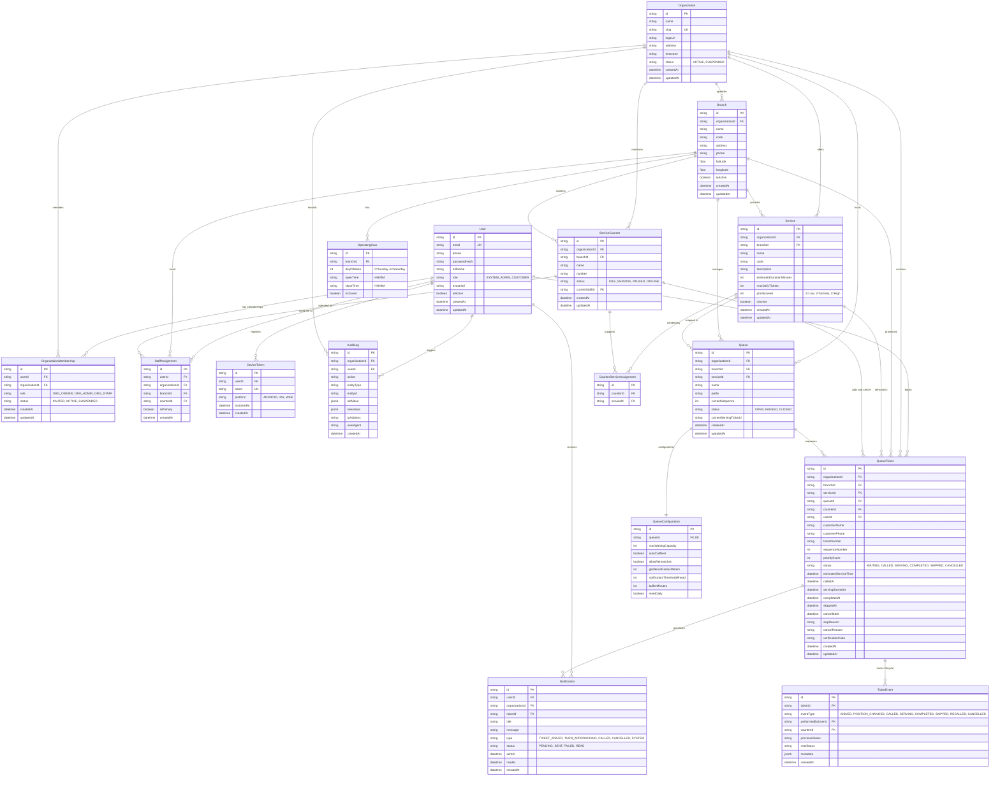

# QueueLess: Database Design & ERD

## 1. Entity-Relationship Diagram (ERD)

---

## 2. Table Specifications, Constraints, and Indexes

### 2.1 `User`
- **Primary Key**: `id` (UUID / CUID)
- **Unique**: `email`
- **Indexes**:
  - `idx_user_email` on (`email`)
  - `idx_user_phone` on (`phone`)
  - `idx_user_role` on (`role`)

### 2.2 `Organization`
- **Primary Key**: `id`
- **Unique**: `slug`
- **Indexes**:
  - `idx_org_slug` on (`slug`)
  - `idx_org_status` on (`status`)

### 2.3 `OrganizationMembership`
- **Primary Key**: `id`
- **Foreign Keys**:
  - `userId` REFERENCES `User(id)` ON DELETE CASCADE
  - `organizationId` REFERENCES `Organization(id)` ON DELETE CASCADE
- **Unique**: (`userId`, `organizationId`)
- **Indexes**:
  - `idx_membership_user` on (`userId`)
  - `idx_membership_org` on (`organizationId`)
  - `idx_membership_role` on (`organizationId`, `role`)

### 2.4 `Branch`
- **Primary Key**: `id`
- **Foreign Keys**:
  - `organizationId` REFERENCES `Organization(id)` ON DELETE CASCADE
- **Unique**: (`organizationId`, `code`)
- **Indexes**:
  - `idx_branch_org` on (`organizationId`)
  - `idx_branch_active` on (`organizationId`, `isActive`)
  - `idx_branch_coords` on (`latitude`, `longitude`)

### 2.5 `OperatingHour`
- **Primary Key**: `id`
- **Foreign Keys**:
  - `branchId` REFERENCES `Branch(id)` ON DELETE CASCADE
- **Unique**: (`branchId`, `dayOfWeek`)

### 2.6 `Service`
- **Primary Key**: `id`
- **Foreign Keys**:
  - `organizationId` REFERENCES `Organization(id)` ON DELETE CASCADE
  - `branchId` REFERENCES `Branch(id)` ON DELETE CASCADE
- **Unique**: (`branchId`, `code`)
- **Indexes**:
  - `idx_service_branch` on (`branchId`, `isActive`)
  - `idx_service_org` on (`organizationId`)

### 2.7 `ServiceCounter`
- **Primary Key**: `id`
- **Foreign Keys**:
  - `organizationId` REFERENCES `Organization(id)` ON DELETE CASCADE
  - `branchId` REFERENCES `Branch(id)` ON DELETE CASCADE
  - `currentStaffId` REFERENCES `User(id)` ON DELETE SET NULL
- **Unique**: (`branchId`, `number`)
- **Indexes**:
  - `idx_counter_branch` on (`branchId`, `status`)

### 2.8 `CounterServiceAssignment`
- **Primary Key**: `id`
- **Foreign Keys**:
  - `counterId` REFERENCES `ServiceCounter(id)` ON DELETE CASCADE
  - `serviceId` REFERENCES `Service(id)` ON DELETE CASCADE
- **Unique**: (`counterId`, `serviceId`)

### 2.9 `StaffAssignment`
- **Primary Key**: `id`
- **Foreign Keys**:
  - `userId` REFERENCES `User(id)` ON DELETE CASCADE
  - `organizationId` REFERENCES `Organization(id)` ON DELETE CASCADE
  - `branchId` REFERENCES `Branch(id)` ON DELETE CASCADE
  - `counterId` REFERENCES `ServiceCounter(id)` ON DELETE SET NULL
- **Unique**: (`userId`, `branchId`)

### 2.10 `Queue`
- **Primary Key**: `id`
- **Foreign Keys**:
  - `organizationId` REFERENCES `Organization(id)` ON DELETE CASCADE
  - `branchId` REFERENCES `Branch(id)` ON DELETE CASCADE
  - `serviceId` REFERENCES `Service(id)` ON DELETE CASCADE
- **Unique**: (`branchId`, `serviceId`)
- **Indexes**:
  - `idx_queue_branch` on (`branchId`, `status`)

### 2.11 `QueueConfiguration`
- **Primary Key**: `id`
- **Foreign Keys**:
  - `queueId` REFERENCES `Queue(id)` ON DELETE CASCADE
- **Unique**: (`queueId`)

### 2.12 `QueueTicket`
- **Primary Key**: `id`
- **Foreign Keys**:
  - `organizationId` REFERENCES `Organization(id)` ON DELETE RESTRICT
  - `branchId` REFERENCES `Branch(id)` ON DELETE RESTRICT
  - `serviceId` REFERENCES `Service(id)` ON DELETE RESTRICT
  - `queueId` REFERENCES `Queue(id)` ON DELETE RESTRICT
  - `counterId` REFERENCES `ServiceCounter(id)` ON DELETE SET NULL
  - `userId` REFERENCES `User(id)` ON DELETE SET NULL
- **Unique**: (`queueId`, `sequenceNumber`)
- **Indexes**:
  - `idx_ticket_active_user` on (`userId`, `status`) WHERE status IN ('WAITING', 'CALLED', 'SERVING')
  - `idx_ticket_queue_status_prio` on (`queueId`, `status`, `priorityScore` DESC, `sequenceNumber` ASC)
  - `idx_ticket_branch_date` on (`branchId`, `createdAt`)
  - `idx_ticket_counter` on (`counterId`, `status`)

### 2.13 `TicketEvent`
- **Primary Key**: `id`
- **Foreign Keys**:
  - `ticketId` REFERENCES `QueueTicket(id)` ON DELETE CASCADE
  - `performedByUserId` REFERENCES `User(id)` ON DELETE SET NULL
- **Indexes**:
  - `idx_ticket_event_ticket` on (`ticketId`, `createdAt` ASC)

### 2.14 `Notification`
- **Primary Key**: `id`
- **Foreign Keys**:
  - `userId` REFERENCES `User(id)` ON DELETE CASCADE
  - `ticketId` REFERENCES `QueueTicket(id)` ON DELETE SET NULL
- **Indexes**:
  - `idx_notification_user_unread` on (`userId`, `status`)

### 2.15 `DeviceToken`
- **Primary Key**: `id`
- **Foreign Keys**:
  - `userId` REFERENCES `User(id)` ON DELETE CASCADE
- **Unique**: (`token`)
- **Indexes**:
  - `idx_devicetoken_user` on (`userId`)

### 2.16 `AuditLog`
- **Primary Key**: `id`
- **Foreign Keys**:
  - `organizationId` REFERENCES `Organization(id)` ON DELETE CASCADE
  - `userId` REFERENCES `User(id)` ON DELETE SET NULL
- **Indexes**:
  - `idx_audit_org_created` on (`organizationId`, `createdAt` DESC)
  - `idx_audit_entity` on (`entityType`, `entityId`)
